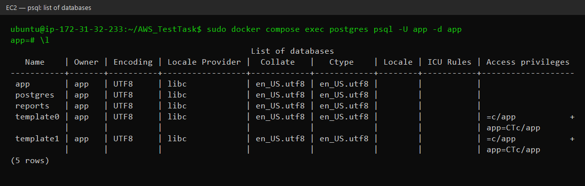
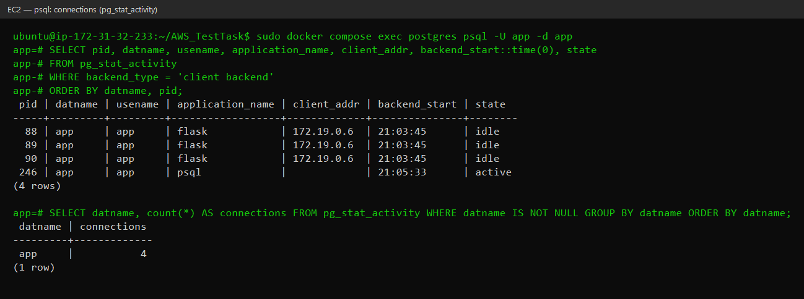
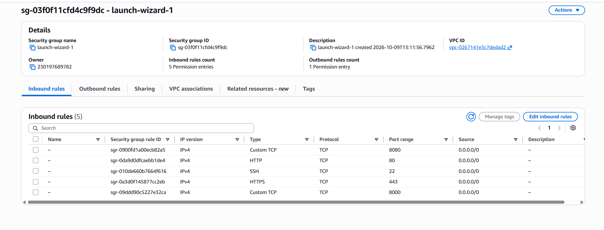

# AWS_TestTask

# AWS DevOps Lab — EC2, Docker Compose, Redis, Ansible

Hands-on DevOps practice following my mentor's roadmap.

Three web applications — PHP, Python (Flask) and Node.js (Express) — run in Docker containers on an AWS EC2 instance behind nginx. Each application has its own database (MySQL, PostgreSQL, MongoDB), and all three share one **Redis** that counts every hit. The whole server — from a bare Ubuntu instance to the running stack — is set up by **Ansible**.

> This README describes only the **current** setup. Earlier architectures (apps directly on the host with systemd; Docker deployed by hand) are in the [archive](archive/README.md).

## Task

Stage 3 (current):

1. Add **Redis** shared between the applications. Every hit to any application increments a common counter in Redis; the counter has a **TTL of 3 days**.
2. **Archive** the old architecture; the main page keeps only the current documentation.
3. Prepare **Ansible** to bring up such a machine at any moment.

Earlier stages: [Stage 1 — host](archive/stage1-host/README.md#task), [Stage 2 — Docker](archive/stage2-docker/README.md#task).

## Status

- [x] Redis in the stack, reachable only from the apps (internal `db` network, password)
- [x] Every request to PHP, Python and Node.js increments `hits:total` and `hits:<app>`, TTL 3 days
- [x] `/hits` page in every app shows the shared counters
- [x] The sites keep working when Redis is down (the hit is just not counted)
- [x] Stage 1 and Stage 2 docs and files moved to [archive/](archive/README.md)
- [x] Ansible: `site.yml` configures any Ubuntu 24.04 server and starts the stack
- [x] Ansible: `ec2.yml` creates a new EC2 instance and deploys on it; `ec2-destroy.yml` removes it
- [ ] Deploy with Ansible to EC2 and add screenshots of `/hits` and `redis-cli`

## Architecture


| Service | Image | Networks | Host port | Purpose |
|---|---|---|---|---|
| `nginx` | `nginx:1.27-alpine` | web | 80, 8000, 8080 | Reverse proxy for the three sites |
| `php` | built from [php/Dockerfile](php/Dockerfile) (`php:8.3-fpm-alpine` + `pdo_mysql`, `mysqli`, `redis`) | web, db | — | Site 1 |
| `python` | built from [python/Dockerfile](python/Dockerfile) (`python:3.12-slim`, gunicorn) | web, db | — | Site 2 |
| `node` | built from [node/Dockerfile](node/Dockerfile) (`node:24-alpine`) | web, db | — | Site 3 |
| `phpmyadmin` | `phpmyadmin:5.2` | web, db | 8081 | MySQL admin UI |
| `pgadmin` | `dpage/pgadmin4:9` | web, db | 8082 | PostgreSQL admin UI |
| `mysql` | `mysql:8.4` | db | — | Database for PHP |
| `postgres` | `postgres:17-alpine` | db | — | Database for Python (`app`, `reports`) |
| `mongo` | `mongo:8` | db | — | Database for Node.js |
| `redis` | `redis:7.4-alpine` | db | — | Shared hit counter for all three apps |

### Networks

- **`web`** — nginx, the applications and the admin tools.
- **`db`** — the databases and Redis. The network is `internal: true`: containers in it have no internet access and their ports cannot be published to the host.
- The applications and the admin tools are connected to **both** networks — they serve HTTP on `web` and talk to their database and Redis on `db`. nginx is only in `web`, so it cannot reach the databases.

Containers find each other by service name through Docker's DNS: nginx uses `php:9000`, `python:5000`, `node:3000`; the apps use `mysql`, `postgres`, `mongo`, `redis`.

## Shared hit counter (Redis)

Every request to any of the three applications increments two keys in the same Redis:

| Key | Incremented by |
|---|---|
| `hits:total` | every app — the common counter |
| `hits:php`, `hits:python`, `hits:node` | only that app |

How each app counts the hit:

| App | Where | Client |
|---|---|---|
| PHP | [php/hits/counter.php](php/hits/counter.php), run before **every** PHP script via `auto_prepend_file` ([php/hits/hits.ini](php/hits/hits.ini)). It lives outside the web root, so it cannot be opened by URL | `phpredis` extension, persistent connection per php-fpm worker |
| Python | `@app.before_request` in [python/app.py](python/app.py) | `redis` (redis-py) |
| Node.js | Express middleware in [node/server.js](node/server.js), not awaited — the response does not wait for Redis | `redis` (node-redis 4) |

All three send the same transaction:

```
MULTI
INCR   hits:total
EXPIRE hits:total 259200 NX
INCR   hits:<app>
EXPIRE hits:<app> 259200 NX
EXEC
```

**TTL — 3 days.** `EXPIRE ... NX` sets the TTL only when the key has no TTL yet, i.e. on the first hit after the key was created. So the counter covers a fixed 3-day window: 3 days after the first hit the key expires and counting starts again from 0. Without `NX` every hit would push the expiry forward, and with steady traffic the counter would never expire. The TTL is configurable with `HITS_TTL` in `.env` (seconds).

**If Redis is down** the sites keep working: the clients use short timeouts (0.5 s), errors are only logged, and the hit is not counted. The apps start only after Redis is healthy (`depends_on: condition: service_healthy`), but they do not need it to answer requests.

Redis itself: password (`--requirepass`), AOF persistence in the `redis_data` volume (counters and their TTL survive a restart), `maxmemory 64mb`.

### Checking the counter

Each app has a page that reads the shared counters:

| URL | Served by |
|---|---|
| `http://<EC2_PUBLIC_IP>/hits.php` | PHP |
| `http://<EC2_PUBLIC_IP>:8000/hits` | Python |
| `http://<EC2_PUBLIC_IP>:8080/hits` | Node.js |

```json
{"total": 42, "php": 10, "python": 20, "node": 12, "ttl_seconds": 258731, "served_by": "python"}
```

All three pages show the same numbers — they read the same keys. Directly in Redis:

```bash
docker compose exec redis redis-cli            # password comes from REDISCLI_AUTH
127.0.0.1:6379> MGET hits:total hits:php hits:python hits:node
127.0.0.1:6379> TTL hits:total
```

## Deploy with Ansible

Everything that was done by hand in Stage 2 (swap, Docker, copying the project, `.env` with random passwords, `docker compose up`) is now in [ansible/](ansible/).

| File | Purpose |
|---|---|
| [ansible/site.yml](ansible/site.yml) | Configure a server from the inventory and start the stack |
| [ansible/ec2.yml](ansible/ec2.yml) | Create a new EC2 instance (security group, 20 GB disk), then run `site.yml` on it |
| [ansible/ec2-destroy.yml](ansible/ec2-destroy.yml) | Terminate that instance and delete its security group |
| [ansible/group_vars/all.yml](ansible/group_vars/all.yml) | Settings: project path, swap size, ports, TTL |
| [ansible/inventory.ini.example](ansible/inventory.ini.example) | Template for `inventory.ini` (server address and SSH key; `inventory.ini` is in `.gitignore`) |
| [ansible/requirements.yml](ansible/requirements.yml) | Collections: `community.docker`, `amazon.aws` |

`site.yml` runs three roles:

| Role | What it does |
|---|---|
| [base](ansible/roles/base/tasks/main.yml) | Checks free disk space (before the first install), installs base packages, creates a 2 GB swap file and keeps it in `/etc/fstab` |
| [docker](ansible/roles/docker/tasks/main.yml) | Docker Engine + Compose plugin from the official Docker repository, adds `ubuntu` to the `docker` group |
| [app](ansible/roles/app/tasks/main.yml) | Copies the project to `~/AWS_TestTask`, creates `.env`, runs `docker compose up` (rebuilds the images only when the files changed), waits for the healthchecks and checks `/db` of every site |

The playbooks are idempotent — running them again changes only what is different. **`.env` is never overwritten:** Ansible only adds variables that are missing, with a random 32-character password where needed. Existing passwords stay, because the database volumes are already initialised with them.

### Control machine

Ansible does not run on Windows — use WSL (Ubuntu) or Linux. Tested with `ansible-core` 2.21.

```bash
python3 -m venv ~/.venvs/ansible
~/.venvs/ansible/bin/pip install ansible-core boto3     # boto3 — only for ec2.yml
source ~/.venvs/ansible/bin/activate

cd ansible
ansible-galaxy collection install -r requirements.yml
```

Two WSL details when the repository is on the Windows drive (`/mnt/c/...`):

- `/mnt/c` is world-writable, so Ansible **ignores** `ansible.cfg` there. Point to it explicitly: `export ANSIBLE_CONFIG=$PWD/ansible.cfg`.
- SSH refuses a private key with `0777` permissions, and `chmod` does not work on `/mnt/c`. Copy the key into WSL: `cp <key>.pem ~/.ssh/ && chmod 400 ~/.ssh/<key>.pem`.

### A. Existing server

```bash
cp inventory.ini.example inventory.ini   # set ansible_host and the key path
ansible app -m ping
ansible-playbook site.yml
```

### B. New EC2 instance from scratch

Needs AWS credentials (`aws configure` or `AWS_PROFILE`) and an existing key pair in the region.

```bash
ansible-playbook ec2.yml -e ec2_key_name=<key pair name> -e ec2_private_key=~/.ssh/<key>.pem
```

`ec2.yml`:

1. finds the latest Ubuntu 24.04 AMI from Canonical;
2. creates the security group `aws-testtask-ansible`: 80, 443, 8000, 8080 for everyone, **22 only for the public IP of the machine that runs Ansible** (or `-e ssh_cidr=...`);
3. starts a `t3.micro` with a 20 GB gp3 root volume (the default 8 GB is not enough for the images);
4. waits for SSH and cloud-init and runs `site.yml` on it.

The last task prints the counter read through the new server, and the instance ID and URL are shown above it. To remove everything (all data on the instance is lost):

```bash
ansible-playbook ec2-destroy.yml
```

## Run locally

```bash
cp .env.example .env      # set the passwords; change the ports if 80/8000/8080 are taken
docker compose up -d --build
curl localhost:8000/hits
```

## Configuration: `.env`

All passwords and names are in `.env` next to `docker-compose.yml`. The file is in `.gitignore`; only [.env.example](.env.example) is committed. On the server Ansible creates it.

```
MYSQL_ROOT_PASSWORD=...        MYSQL_DATABASE=app   MYSQL_USER=app   MYSQL_PASSWORD=...
POSTGRES_DB=app                POSTGRES_EXTRA_DATABASES=reports
POSTGRES_USER=app              POSTGRES_PASSWORD=...
MONGO_USER=app                 MONGO_PASSWORD=...
REDIS_PASSWORD=...             HITS_TTL=259200
PGADMIN_EMAIL=...              PGADMIN_PASSWORD=...
PHP_PORT=80  PYTHON_PORT=8000  NODE_PORT=8080  PHPMYADMIN_PORT=8081  PGADMIN_PORT=8082
```

`docker compose` stops with an error if `REDIS_PASSWORD` is not set, so Redis never starts without a password.

## PostgreSQL: two databases

The official `postgres` image creates one database — `POSTGRES_DB` (`app`, used by Flask). The second one (`reports`) is created by [postgres/init/01-create-databases.sh](postgres/init/01-create-databases.sh). Every `*.sh` / `*.sql` file mounted into `/docker-entrypoint-initdb.d/` runs once, on the first start with an empty data volume:

```sh
for db in $(echo "$POSTGRES_EXTRA_DATABASES" | tr ',' ' '); do
    psql -v ON_ERROR_STOP=1 -U "$POSTGRES_USER" -d postgres \
        -c "CREATE DATABASE \"$db\" OWNER \"$POSTGRES_USER\";"
done
```

> The init scripts do not run again when the volume already has data. To add a database later — create it by hand (`CREATE DATABASE ...`) or recreate the volume with `docker compose down -v` (this **deletes all data**).

```bash
docker compose exec postgres psql -U app -d app
```

List of databases (`\l`) — `app` and `reports` are ours, `postgres`, `template0`, `template1` are system databases:



Connections to the database:

```sql
SELECT pid, datname, usename, application_name, client_addr, backend_start::time(0), state
FROM pg_stat_activity
WHERE backend_type = 'client backend'
ORDER BY datname, pid;
```



- **3 × `flask`** from `172.19.0.6` — the `python` container in the `db` network. gunicorn runs 3 workers, and each worker keeps one open connection in its pool (`psycopg-pool`, `min_size=1`). The pool sets `application_name=flask`, so the connections are easy to find.
- **1 × `psql`** — my own session. `client_addr` is empty because `psql` connects through the local unix socket inside the container.
- Nothing is connected to `reports` yet — no application uses it.

## Security group

| Port | Source | Purpose |
|---|---|---|
| 22 | my IP (`ec2.yml` sets it automatically) | SSH |
| 80 | 0.0.0.0/0 | Site 1 — PHP |
| 443 | 0.0.0.0/0 | HTTPS (reserved, TLS is not configured yet) |
| 8000 | 0.0.0.0/0 | Site 2 — Flask |
| 8080 | 0.0.0.0/0 | Site 3 — Node.js |



The screenshot is of the manually created group, where SSH is still open to `0.0.0.0/0`.

## Project files

| File | Purpose |
|---|---|
| [docker-compose.yml](docker-compose.yml) | All services, networks and volumes |
| [nginx/docker.conf](nginx/docker.conf) | nginx: one `server` block per port, backends by service name |
| [php/Dockerfile](php/Dockerfile) | PHP image: `pdo_mysql`, `mysqli`, `phpredis`, the hit counter |
| [php/public/](php/public/) | Web root of site 1: `index.php`, `db.php`, `hits.php` |
| [php/hits/](php/hits/) | Hit counter prepended to every PHP request (outside the web root) |
| [python/app.py](python/app.py), [python/requirements.txt](python/requirements.txt) | Flask app: `/`, `/db`, `/hits` |
| [node/server.js](node/server.js), [node/package.json](node/package.json) | Express app: `/`, `/api/time`, `/db`, `/hits` |
| [postgres/init/01-create-databases.sh](postgres/init/01-create-databases.sh) | Creates the extra PostgreSQL databases on the first start |
| [pgadmin/servers.json](pgadmin/servers.json) | Pre-registers the PostgreSQL server in pgAdmin |
| [.env.example](.env.example) | Template for `.env` |
| [ansible/](ansible/) | Server setup and deployment — see [Deploy with Ansible](#deploy-with-ansible) |
| [archive/](archive/README.md) | Earlier architectures, kept for history |

The Python and Node.js images run as a non-root user.

## Environment

| Component | Version |
|---|---|
| Cloud | AWS EC2, region `us-east-1` (N. Virginia), `t3.micro` |
| OS | Ubuntu 24.04 LTS |
| Root volume | EBS 20 GB + 2 GB swap |
| Docker Engine / Compose | 29.9 / v5.6 |
| nginx | 1.27 (`nginx:1.27-alpine`) |
| PHP | 8.3 (`php:8.3-fpm-alpine`), phpredis 6.1 |
| Python | 3.12 (`python:3.12-slim`), Flask 3.1, redis-py 5 |
| Node.js | 24 (`node:24-alpine`), Express 4, node-redis 4 |
| MySQL | 8.4 |
| PostgreSQL | 17 |
| MongoDB | 8 |
| Redis | 7.4 (`redis:7.4-alpine`) |
| phpMyAdmin / pgAdmin | 5.2 / 9 |
| Ansible | ansible-core 2.21, `community.docker`, `amazon.aws` |

## Problems and solutions

Problems from the earlier stages are in the [archive](archive/README.md); the ones below still matter for the current setup.

**1. Not enough disk space for the images**
- *Cause:* the default 8 GB root volume. The images take about 8 GB on disk — Docker keeps both the compressed layers and the unpacked ones.
- *Fix:* `ec2.yml` creates the instance with a 20 GB volume; the `base` role stops the run before the first Docker install if less than 10 GB is free. An existing volume can be resized in the AWS console (EC2 → Volumes → Modify volume), then `sudo growpart /dev/nvme0n1 1 && sudo resize2fs /dev/nvme0n1p1`.

**2. Not enough RAM on `t3.micro`**
- *Cause:* 1 GB of RAM is not enough for MySQL, PostgreSQL, MongoDB and pgAdmin together — the OOM killer stops containers.
- *Fix:* 2 GB swap file (the `base` role). The stack works, but it is slow; `t3.small` / `t3.medium` would be better (`-e ec2_instance_type=t3.small`).

**3. Node.js app not reachable from nginx**
- *Cause:* inside a container `127.0.0.1` is the container's own loopback.
- *Fix:* the listen address comes from the `HOST` variable, `0.0.0.0` in `docker-compose.yml`.

**4. Init script breaking because of Windows line endings**
- *Cause:* with `core.autocrlf=true` Git on Windows checks out `.sh` files with CRLF; `sh` in the container then fails on `\r`.
- *Fix:* [.gitattributes](.gitattributes) with `*.sh text eol=lf`.

**5. node-redis queued hits in memory while Redis was down**
- *Cause:* `disableOfflineQueue` makes single commands fail fast, but `MULTI` transactions skip that check in node-redis 4 and wait in the queue until Redis comes back — with a long outage the queue grows without limit.
- *Fix:* `countHit()` returns early when `redis.isReady` is false, so the hit is skipped, the same as in PHP and Python.

**6. Counter must not break the PHP pages**
- *Cause:* the counter runs before every PHP script; an exception there would turn every page into an error.
- *Fix:* everything is inside `try/catch (Throwable)` with a 0.5 s connect timeout, errors go to the log only. The counter skips the CLI (`php` run by hand in the container is not a hit).

**7. `ansible.cfg` ignored in WSL**
- *Cause:* files under `/mnt/c` are world-writable, and Ansible refuses to load a config from a world-writable directory.
- *Fix:* `export ANSIBLE_CONFIG=$PWD/ansible.cfg` (or keep the repository in the WSL home directory).

## Security notes

- Only nginx is exposed to the internet. The applications have no published ports; the databases and Redis are in the internal `db` network and cannot be reached from the host or the internet.
- Passwords are random (32 characters, generated by Ansible) and stored in `.env` on the server (`chmod 600`, in `.gitignore`). Redis requires a password; `docker compose` refuses to start without one.
- `site 1` (`/`) is `phpinfo()`, which prints the environment of the PHP container — including the MySQL and Redis passwords. These services are not reachable from outside, but the page should be replaced (see [Next steps](#next-steps)).
- phpMyAdmin (8081) and pgAdmin (8082) are published on the host, but these ports are **closed** in the security group. To use them — an SSH tunnel:
  ```bash
  ssh -i <key>.pem -L 8082:localhost:8082 ubuntu@<EC2_PUBLIC_IP>   # then open http://localhost:8082
  ```
- SSH: `ec2.yml` opens 22 only for the IP of the machine that runs Ansible. If the IP changes, run `ec2.yml` again — it updates the rule.
- Port 443 is open, but TLS is not configured yet.
- Private keys (`.pem`, CI key) and `ansible/inventory.ini` are never committed. The public IP and AWS account ID are hidden in this README and in the screenshots.

## Next steps

Roadmap:

1. Move the three applications to Git repositories and deploy from them
2. CI/CD pipeline (GitHub Actions / GitLab CI) that runs the Ansible playbook with the dedicated SSH key
3. ~~Containerization (Docker)~~ — done in Stage 2
4. Load balancer
5. Infrastructure as Code with Terraform (the EC2 part of `ec2.yml` is a first step)
6. ~~Databases: PostgreSQL and MySQL~~ — done in Stage 2 (+ MongoDB)
7. ~~Redis + configuration management with Ansible~~ — done in Stage 3

Small fixes:

- replace `phpinfo()` on site 1 with a page that does not print the environment;
- bind phpMyAdmin and pgAdmin to `127.0.0.1` on the host, so they are reachable only through the SSH tunnel even if the security group is opened by mistake;
- regenerate `node/package-lock.json` with `npm install` (`mongodb` and `redis` were added without updating the lock file, so the image uses `npm install` instead of `npm ci`);
- use the `reports` database in an application;
- HTTPS for the sites.
