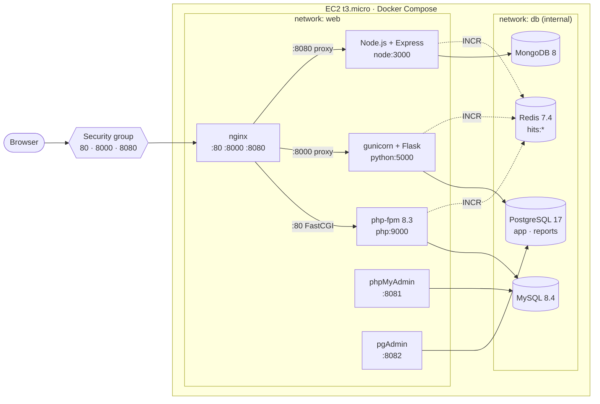
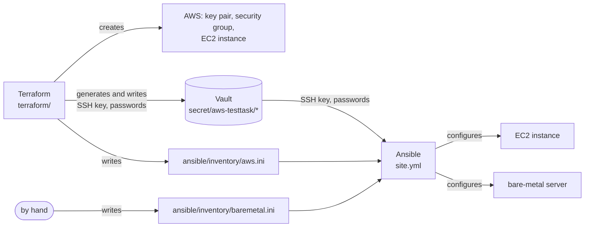

# AWS_TestTask

# AWS DevOps Lab — EC2, Docker Compose, Redis, Terraform, Ansible, Vault

Hands-on DevOps practice following my mentor's roadmap.

Three web applications — PHP, Python (Flask) and Node.js (Express) — run in Docker containers on an AWS EC2 instance behind nginx. Each application has its own database (MySQL, PostgreSQL, MongoDB), and all three share one **Redis** that counts every hit.

The three tools have separate jobs:

- **Terraform** creates everything on AWS — the key pair, the security group, the EC2 instance — and generates the secrets.
- **Vault** keeps the secrets — the SSH key of the instance and the passwords of the stack. They exist only there: not in git, not in the Terraform state.
- **Ansible** configures a server that already exists — swap, Docker, the whole stack, `.env` with the passwords from Vault. The same playbook works on the EC2 instance and on a bare-metal server.

> This README describes only the **current** setup. Earlier architectures (apps directly on the host with systemd; Docker deployed by hand) are in the [archive](archive/README.md).

## Task

Stage 4 (current):

1. **Terraform** for everything on AWS: the instance, the security group, the **key pair** — nothing is created by hand any more.
2. Delete everything that exists on AWS (**to zero**), bring it up again with Terraform + Ansible and get the same result.
3. The secrets — the SSH key and the passwords — are kept in **Vault**.

Stage 3:

1. Add **Redis** shared between the applications. Every hit to any application increments a common counter in Redis; the counter has a **TTL of 3 days**.
2. **Archive** the old architecture; the main page keeps only the current documentation.
3. Prepare **Ansible** to bring up such a machine at any moment.
4. Mentor's review: Ansible is for configuration, not for creating instances. The instance is created by **Terraform**; Ansible configures the whole stack — on AWS and on bare metal.

Earlier stages: [Stage 1 — host](archive/stage1-host/README.md#task), [Stage 2 — Docker](archive/stage2-docker/README.md#task).

## Status

- [x] Redis in the stack, reachable only from the apps (internal `db` network, password)
- [x] Every request to PHP, Python and Node.js increments `hits:total` and `hits:<app>`, TTL 3 days
- [x] `/hits` page in every app shows the shared counters
- [x] The sites keep working when Redis is down (the hit is just not counted)
- [x] Stage 1 and Stage 2 docs and files moved to [archive/](archive/README.md)
- [x] Ansible: `site.yml` configures any Ubuntu 24.04 / Debian 12 server (EC2 or bare metal) and starts the stack
- [x] Terraform: creates the security group and the EC2 instance and writes the Ansible inventory for it
- [x] Ansible no longer creates or deletes EC2 instances (`ec2.yml` / `ec2-destroy.yml` removed)
- [x] Terraform: creates the key pair too; no resource has to exist before `terraform apply`
- [x] Vault: local server ([vault/](vault/)), KV v2, a token that can only touch `secret/aws-testtask/*`
- [x] Terraform generates the SSH key and the passwords and writes them to Vault; the state does not contain them
- [x] Ansible reads the SSH key and the passwords from Vault; `.env` on the server is rendered from Vault
- [x] [scripts/aws-wipe.sh](scripts/aws-wipe.sh) — lists and deletes everything left in the region (the "to zero" step)
- [ ] Wipe AWS to zero → `terraform apply` → `ansible-playbook site.yml`, check the sites; `terraform destroy` → again → the same result
- [ ] Screenshots of `/hits`, `redis-cli` and `vault kv list`
- [ ] Run `site.yml` on a bare-metal server

## Architecture



| Service | Image | Networks | Host port | Purpose |
|---|---|---|---|---|
| `nginx` | `nginx:1.27-alpine` | web | 80, 8000, 8080 | Reverse proxy for the three sites |
| `php` | built from [php/Dockerfile](php/Dockerfile) (`php:8.3-fpm-alpine` + `pdo_mysql`, `mysqli`, `redis`) | web, db | — | Site 1 |
| `python` | built from [python/Dockerfile](python/Dockerfile) (`python:3.12-slim`, gunicorn) | web, db | — | Site 2 |
| `node` | built from [node/Dockerfile](node/Dockerfile) (`node:24-alpine`) | web, db | — | Site 3 |
| `phpmyadmin` | `phpmyadmin:5.2` | web, db | 8081 | MySQL admin UI |
| `pgadmin` | `dpage/pgadmin4:9` | web, db | 8082 | PostgreSQL admin UI |
| `mysql` | `mysql:8.4` | db | — | Database for PHP |
| `postgres` | `postgres:17-alpine` | db | — | Database for Python (`app`, `reports`) |
| `mongo` | `mongo:8` | db | — | Database for Node.js |
| `redis` | `redis:7.4-alpine` | db | — | Shared hit counter for all three apps |

### Networks

- **`web`** — nginx, the applications and the admin tools.
- **`db`** — the databases and Redis. The network is `internal: true`: containers in it have no internet access and their ports cannot be published to the host.
- The applications and the admin tools are connected to **both** networks — they serve HTTP on `web` and talk to their database and Redis on `db`. nginx is only in `web`, so it cannot reach the databases.

Containers find each other by service name through Docker's DNS: nginx uses `php:9000`, `python:5000`, `node:3000`; the apps use `mysql`, `postgres`, `mongo`, `redis`.

## Shared hit counter (Redis)

Every request to any of the three applications increments two keys in the same Redis:

| Key | Incremented by |
|---|---|
| `hits:total` | every app — the common counter |
| `hits:php`, `hits:python`, `hits:node` | only that app |

How each app counts the hit:

| App | Where | Client |
|---|---|---|
| PHP | [php/hits/counter.php](php/hits/counter.php), run before **every** PHP script via `auto_prepend_file` ([php/hits/hits.ini](php/hits/hits.ini)). It lives outside the web root, so it cannot be opened by URL | `phpredis` extension, persistent connection per php-fpm worker |
| Python | `@app.before_request` in [python/app.py](python/app.py) | `redis` (redis-py) |
| Node.js | Express middleware in [node/server.js](node/server.js), not awaited — the response does not wait for Redis | `redis` (node-redis 4) |

All three send the same transaction:

```
MULTI
INCR   hits:total
EXPIRE hits:total 259200 NX
INCR   hits:<app>
EXPIRE hits:<app> 259200 NX
EXEC
```

**TTL — 3 days.** `EXPIRE ... NX` sets the TTL only when the key has no TTL yet, i.e. on the first hit after the key was created. So the counter covers a fixed 3-day window: 3 days after the first hit the key expires and counting starts again from 0. Without `NX` every hit would push the expiry forward, and with steady traffic the counter would never expire. The TTL is configurable with `HITS_TTL` in `.env` (seconds).

**If Redis is down** the sites keep working: the clients use short timeouts (0.5 s), errors are only logged, and the hit is not counted. The apps start only after Redis is healthy (`depends_on: condition: service_healthy`), but they do not need it to answer requests.

Redis itself: password (`--requirepass`), AOF persistence in the `redis_data` volume (counters and their TTL survive a restart), `maxmemory 64mb`.

### Checking the counter

Each app has a page that reads the shared counters:

| URL | Served by |
|---|---|
| `http://<EC2_PUBLIC_IP>/hits.php` | PHP |
| `http://<EC2_PUBLIC_IP>:8000/hits` | Python |
| `http://<EC2_PUBLIC_IP>:8080/hits` | Node.js |

```json
{"total": 42, "php": 10, "python": 20, "node": 12, "ttl_seconds": 258731, "served_by": "python"}
```

All three pages show the same numbers — they read the same keys. Directly in Redis:

```bash
docker compose exec redis redis-cli            # password comes from REDISCLI_AUTH
127.0.0.1:6379> MGET hits:total hits:php hits:python hits:node
127.0.0.1:6379> TTL hits:total
```

## Deploy: Vault + Terraform + Ansible



| Tool | Job | Does **not** do |
|---|---|---|
| Vault | Keeps the secrets; gives them only to a token with the `aws-testtask` policy | Generate them |
| Terraform | Creates, changes and deletes the AWS resources; generates the secrets and writes them to Vault | Install software on the server; keep the secrets in its state |
| Ansible | Configures an existing server: swap, Docker, the project, `.env` from Vault, `docker compose up` | Create or delete servers; generate passwords |

Adding a bare-metal server is only a line in the inventory — Ansible does not care where the server comes from.

All commands run in **WSL** (Ubuntu) or Linux — Ansible does not run on Windows.

### 0. Secrets — Vault

Vault runs on the machine that runs Terraform and Ansible (not on the EC2 instance): one node, file storage, port 8200 only on `127.0.0.1`.

| File | Purpose |
|---|---|
| [vault/docker-compose.yml](vault/docker-compose.yml) | `hashicorp/vault:2.2`, storage in the `vault_data` volume |
| [vault/config/vault.hcl](vault/config/vault.hcl) | Server config: file storage, HTTP listener, UI |
| [vault/bootstrap.sh](vault/bootstrap.sh) | First run: init, unseal, KV v2 engine `secret/`, policy, project token. Later runs: unseal + renew the token |
| [vault/policies/aws-testtask.hcl](vault/policies/aws-testtask.hcl) | The project token may only read and write `secret/aws-testtask/*` |

```bash
docker compose -f vault/docker-compose.yml up -d
vault/bootstrap.sh                         # again after every restart of Vault: it starts sealed

export VAULT_ADDR=http://127.0.0.1:8200
export VAULT_TOKEN=$(cat vault/.vault-token)
```

`bootstrap.sh` uses the `vault` CLI if it is installed, otherwise the CLI inside the container. It writes two files, both in `.gitignore`:

- `vault/.vault-init.json` — the unseal key and the root token. Without it the data in Vault cannot be read after a restart: **keep a copy outside this machine** (password manager). The root token is used only by the script.
- `vault/.vault-token` — the token for Terraform and Ansible (`aws-testtask` policy, periodic: valid while it is renewed at least once in 32 days; every run of `bootstrap.sh` renews it).

Secrets in Vault:

| Path | Keys | Written by | Read by |
|---|---|---|---|
| `secret/aws-testtask/ssh` | `private_key`, `public_key` | Terraform | Ansible — writes the key to `~/.ssh/aws-testtask.pem` |
| `secret/aws-testtask/ssh-public` | `public_key` | Terraform | Terraform — for `aws_key_pair` |
| `secret/aws-testtask/app` | `MYSQL_ROOT_PASSWORD`, `MYSQL_PASSWORD`, `POSTGRES_PASSWORD`, `MONGO_PASSWORD`, `REDIS_PASSWORD`, `PGADMIN_PASSWORD` | Terraform | Ansible — writes them to `.env` |

```bash
vault kv list secret/aws-testtask
vault kv get secret/aws-testtask/app
vault kv get -field=private_key secret/aws-testtask/ssh
```

UI: <http://127.0.0.1:8200> (login with the token).

### 1. Infrastructure on AWS — Terraform

| File | Purpose |
|---|---|
| [terraform/main.tf](terraform/main.tf) | Ubuntu 24.04 AMI, key pair, security group, EC2 instance, the Ansible inventory file |
| [terraform/vault.tf](terraform/vault.tf) | The SSH key and the passwords: generated and written to Vault |
| [terraform/variables.tf](terraform/variables.tf) | Region, instance type, disk size, SSH CIDR, open ports, Vault address and paths, `secrets_version` |
| [terraform/outputs.tf](terraform/outputs.tf) | Instance ID, public IP, `ssh` command, URL, Vault paths |
| [terraform/versions.tf](terraform/versions.tf) | Terraform ≥ 1.11, providers `aws` 6.x, `vault` 5.x, `tls`, `random`, `http`, `local` |
| [terraform/terraform.tfvars.example](terraform/terraform.tfvars.example) | Optional overrides — every variable has a default |

What `terraform apply` creates (no resource has to exist before):

1. in Vault — an ED25519 SSH key and six 32-character passwords (see the table above);
2. the key pair `aws-testtask` with the public half of that key;
3. the security group `aws-testtask`: 80, 443, 8000, 8080 for everyone, **22 only for the public IP of the machine that runs Terraform** (or `ssh_cidr`), all outbound traffic;
4. a `t3.micro` from the latest Canonical Ubuntu 24.04 AMI with the key pair, a 20 GB gp3 root volume (the default 8 GB is not enough for the images), IMDSv2 only. A newer AMI later does **not** replace the running instance (`ignore_changes = [ami]`);
5. [ansible/inventory/aws.ini](ansible/inventory/) with the new instance in the `aws` group and the path of the key file.

**Why the secrets are not in the state.** Normally everything a resource generates (`tls_private_key`, `random_password`) is saved in `terraform.tfstate` in plain text. Here they are *ephemeral* resources (Terraform ≥ 1.10): their values live only while Terraform runs. They are written to Vault through the *write-only* attribute `data_json_wo` (Terraform ≥ 1.11), which is never saved to the state either. `data_json_wo_version` decides when the value is written: once, on create, and again only when `secrets_version` changes — so `terraform plan` stays at "No changes". The only thing Terraform reads back is the public key (`ssh-public`), because `aws_key_pair` needs it as a normal value.

Needs AWS credentials (`aws configure` or `AWS_PROFILE`) and `VAULT_ADDR` / `VAULT_TOKEN` from step 0.

```bash
cd terraform
terraform init
terraform plan
terraform apply
```

The state (`terraform.tfstate`) is local and in `.gitignore` — it is needed to change or delete the instance later, do not lose it. If my IP changes, `terraform apply` again updates only the SSH rule. After a stop/start of the instance the public IP changes: `terraform apply -refresh-only` updates the outputs, `terraform apply` rewrites `aws.ini`.

New key and passwords: `terraform apply -var secrets_version=2` (or in `terraform.tfvars`). The key pair changes, so the instance is **replaced** (`replace_triggered_by`) — an existing instance would keep the old key, and its databases the old passwords.

To remove everything (all data on the instance is lost; `aws.ini` and the secrets in Vault are deleted too):

```bash
terraform destroy
```

### 2. Configuration — Ansible

Everything that was done by hand in Stage 2 (swap, Docker, copying the project, `.env`, `docker compose up`) is in [ansible/](ansible/).

| File | Purpose |
|---|---|
| [ansible/site.yml](ansible/site.yml) | Gets the SSH key from Vault, configures every server of the `app` group and starts the stack |
| [ansible/inventory/](ansible/inventory/) | Ansible reads **every** file here: `aws.ini` (written by Terraform) and `baremetal.ini` (by hand, from [baremetal.ini.example](ansible/inventory/baremetal.ini.example)). Both put their hosts into the `app` group. The `.ini` files are in `.gitignore` |
| [ansible/group_vars/all.yml](ansible/group_vars/all.yml) | Settings: project path, swap size, ports, TTL, Vault paths. Any of them can be overridden per host in the inventory |
| [ansible/requirements.yml](ansible/requirements.yml) | Collections `community.docker`, `community.hashi_vault` |

`site.yml` first checks `VAULT_TOKEN` and writes the private key from Vault to the path from `aws.ini` (`~/.ssh/aws-testtask.pem`, `0600`) — on the control machine, before the first SSH connection, and only when an EC2 host is in the run. Then it waits for SSH and cloud-init (skipped on a server without cloud-init), checks that the OS is Ubuntu or Debian and runs three roles:

| Role | What it does |
|---|---|
| [base](ansible/roles/base/tasks/main.yml) | Checks free disk space (before the first install), installs base packages, creates a 2 GB swap file and keeps it in `/etc/fstab` (`swap_size_mb: 0` — no swap) |
| [docker](ansible/roles/docker/tasks/main.yml) | Docker Engine + Compose plugin from the official Docker repository (Ubuntu or Debian), adds the SSH user to the `docker` group |
| [app](ansible/roles/app/tasks/main.yml) | Copies the project to `~/AWS_TestTask`, renders `.env` from [templates/env.j2](ansible/roles/app/templates/env.j2) (passwords from Vault, the rest from the variables), runs `docker compose up` (rebuilds the images only when the files changed), waits for the healthchecks and checks `/db` of every site |

The playbook is idempotent — running it again changes only what is different. **Vault is the source of truth for the passwords:** `.env` is rewritten from Vault on every run, so it changes only when the secret in Vault changes. The database volumes keep the password they were created with, so do not change a password in Vault for a server with data (on AWS `secrets_version` replaces the instance, so this cannot happen there).

#### Control machine

Tested with `ansible-core` 2.21. `hvac` is the Python client for Vault, needed by `community.hashi_vault`.

```bash
python3 -m venv ~/.venvs/ansible
~/.venvs/ansible/bin/pip install ansible-core hvac
source ~/.venvs/ansible/bin/activate

cd ansible
ansible-galaxy collection install -r requirements.yml
```

`/mnt/c` is world-writable, so Ansible **ignores** `ansible.cfg` there when the repository is on the Windows drive. Point to it explicitly: `export ANSIBLE_CONFIG=$PWD/ansible.cfg`. (The SSH key is not a problem any more: Ansible writes it to `~/.ssh` inside WSL with `0600`.)

#### Run

```bash
ansible-inventory --graph        # app → aws (from Terraform) + baremetal (by hand)

ansible-playbook site.yml                     # all servers
ansible-playbook site.yml --limit aws         # only the EC2 instance
ansible-playbook site.yml --limit baremetal   # only the bare-metal servers
```

The last task prints the shared hit counter read through each server.

#### Bare-metal server

Any Ubuntu 24.04 / Debian 12 machine with SSH and a user with `sudo`:

```bash
cp inventory/baremetal.ini.example inventory/baremetal.ini   # address, user, key
ansible-playbook site.yml --limit baremetal
```

The bare-metal server gets the same passwords from Vault (`secret/aws-testtask/app`); its SSH key is your own, not the one in Vault. Differences from EC2 are set per host in the inventory, e.g. `swap_size_mb=0` when the server has enough RAM, or `app_dir=/opt/AWS_TestTask`. There is no security group in front of a bare-metal server, so closing 8081/8082 and SSH is the job of the network firewall.

### 3. From zero and again

The goal of Stage 4: nothing created by hand, everything can be deleted and brought back.

**Once — delete everything that exists.** The old setup had a security group, an instance and a key pair created by hand in the console. [scripts/aws-wipe.sh](scripts/aws-wipe.sh) lists everything of these types in the region — EC2 instances, Elastic IPs, unattached EBS volumes, key pairs, security groups except `default` — and with `--delete` removes them after you type the region name. It deletes **everything** of these types in the region, not only this project, so read the list first. Needs the AWS CLI v2.

```bash
scripts/aws-wipe.sh            # what is there
scripts/aws-wipe.sh --delete   # delete it
```

If an older Terraform state of this project exists, run `terraform destroy` first, so the state does not point to deleted resources.

**Bring it up:**

```bash
docker compose -f vault/docker-compose.yml up -d && vault/bootstrap.sh
export VAULT_ADDR=http://127.0.0.1:8200 VAULT_TOKEN=$(cat vault/.vault-token)

cd terraform && terraform init && terraform apply && cd ..
cd ansible && export ANSIBLE_CONFIG=$PWD/ansible.cfg && ansible-playbook site.yml
```

**Check:** the three sites and `/hits` (see [Checking the counter](#checking-the-counter)), `ssh -i ~/.ssh/aws-testtask.pem ubuntu@<EC2_PUBLIC_IP>`, `vault kv list secret/aws-testtask`.

**Again:** `terraform destroy` removes the instance, the key pair, the security group, `aws.ini` and the secrets in Vault. The same `terraform apply` + `ansible-playbook site.yml` bring back the same stack with a new IP, a new key and new passwords; the databases start empty.

## Run locally

```bash
cp .env.example .env      # set the passwords; change the ports if 80/8000/8080 are taken
docker compose up -d --build
curl localhost:8000/hits
```

## Configuration: `.env`

All passwords and names are in `.env` next to `docker-compose.yml`. The file is in `.gitignore`; only [.env.example](.env.example) is committed. On the server Ansible renders it: the six passwords from Vault (`secret/aws-testtask/app`), the rest from the variables in [roles/app/defaults](ansible/roles/app/defaults/main.yml) and [group_vars](ansible/group_vars/all.yml).

```
MYSQL_ROOT_PASSWORD=...        MYSQL_DATABASE=app   MYSQL_USER=app   MYSQL_PASSWORD=...
POSTGRES_DB=app                POSTGRES_EXTRA_DATABASES=reports
POSTGRES_USER=app              POSTGRES_PASSWORD=...
MONGO_USER=app                 MONGO_PASSWORD=...
REDIS_PASSWORD=...             HITS_TTL=259200
PGADMIN_EMAIL=...              PGADMIN_PASSWORD=...
PHP_PORT=80  PYTHON_PORT=8000  NODE_PORT=8080  PHPMYADMIN_PORT=8081  PGADMIN_PORT=8082
```

`docker compose` stops with an error if `REDIS_PASSWORD` is not set, so Redis never starts without a password.

## PostgreSQL: two databases

The official `postgres` image creates one database — `POSTGRES_DB` (`app`, used by Flask). The second one (`reports`) is created by [postgres/init/01-create-databases.sh](postgres/init/01-create-databases.sh). Every `*.sh` / `*.sql` file mounted into `/docker-entrypoint-initdb.d/` runs once, on the first start with an empty data volume:

```sh
for db in $(echo "$POSTGRES_EXTRA_DATABASES" | tr ',' ' '); do
    psql -v ON_ERROR_STOP=1 -U "$POSTGRES_USER" -d postgres \
        -c "CREATE DATABASE \"$db\" OWNER \"$POSTGRES_USER\";"
done
```

> The init scripts do not run again when the volume already has data. To add a database later — create it by hand (`CREATE DATABASE ...`) or recreate the volume with `docker compose down -v` (this **deletes all data**).

```bash
docker compose exec postgres psql -U app -d app
```

List of databases (`\l`) — `app` and `reports` are ours, `postgres`, `template0`, `template1` are system databases:


Connections to the database:

```sql
SELECT pid, datname, usename, application_name, client_addr, backend_start::time(0), state
FROM pg_stat_activity
WHERE backend_type = 'client backend'
ORDER BY datname, pid;
```


- **3 × `flask`** from `172.19.0.6` — the `python` container in the `db` network. gunicorn runs 3 workers, and each worker keeps one open connection in its pool (`psycopg-pool`, `min_size=1`). The pool sets `application_name=flask`, so the connections are easy to find.
- **1 × `psql`** — my own session. `client_addr` is empty because `psql` connects through the local unix socket inside the container.
- Nothing is connected to `reports` yet — no application uses it.

## Security group

| Port | Source | Purpose |
|---|---|---|
| 22 | my IP (Terraform sets it automatically) | SSH (key pair `aws-testtask`, private key in Vault) |
| 80 | 0.0.0.0/0 | Site 1 — PHP |
| 443 | 0.0.0.0/0 | HTTPS (reserved, TLS is not configured yet) |
| 8000 | 0.0.0.0/0 | Site 2 — Flask |
| 8080 | 0.0.0.0/0 | Site 3 — Node.js |


The screenshot is of the old, manually created group, where SSH is still open to `0.0.0.0/0`. It is deleted in Stage 4; the group is now created only by Terraform.

## Project files

| File | Purpose |
|---|---|
| [docker-compose.yml](docker-compose.yml) | All services, networks and volumes |
| [nginx/docker.conf](nginx/docker.conf) | nginx: one `server` block per port, backends by service name |
| [php/Dockerfile](php/Dockerfile) | PHP image: `pdo_mysql`, `mysqli`, `phpredis`, the hit counter |
| [php/public/](php/public/) | Web root of site 1: `index.php`, `db.php`, `hits.php` |
| [php/hits/](php/hits/) | Hit counter prepended to every PHP request (outside the web root) |
| [python/app.py](python/app.py), [python/requirements.txt](python/requirements.txt) | Flask app: `/`, `/db`, `/hits` |
| [node/server.js](node/server.js), [node/package.json](node/package.json) | Express app: `/`, `/api/time`, `/db`, `/hits` |
| [postgres/init/01-create-databases.sh](postgres/init/01-create-databases.sh) | Creates the extra PostgreSQL databases on the first start |
| [pgadmin/servers.json](pgadmin/servers.json) | Pre-registers the PostgreSQL server in pgAdmin |
| [.env.example](.env.example) | Template for `.env` |
| [vault/](vault/) | Local Vault for the secrets — see [Deploy](#0-secrets--vault) |
| [terraform/](terraform/) | AWS infrastructure: key pair, security group, EC2 instance; the secrets in Vault — see [Deploy](#1-infrastructure-on-aws--terraform) |
| [ansible/](ansible/) | Server configuration and deployment (EC2 and bare metal) — see [Deploy](#2-configuration--ansible) |
| [scripts/aws-wipe.sh](scripts/aws-wipe.sh) | Lists / deletes everything left in the AWS region — see [From zero](#3-from-zero-and-again) |
| [archive/](archive/README.md) | Earlier architectures, kept for history |

The Python and Node.js images run as a non-root user.

## Environment

| Component | Version |
|---|---|
| Cloud | AWS EC2, region `us-east-1` (N. Virginia), `t3.micro` |
| OS | Ubuntu 24.04 LTS |
| Root volume | EBS 20 GB + 2 GB swap |
| Docker Engine / Compose | 29.9 / v5.6 |
| nginx | 1.27 (`nginx:1.27-alpine`) |
| PHP | 8.3 (`php:8.3-fpm-alpine`), phpredis 6.1 |
| Python | 3.12 (`python:3.12-slim`), Flask 3.1, redis-py 5 |
| Node.js | 24 (`node:24-alpine`), Express 4, node-redis 4 |
| MySQL | 8.4 |
| PostgreSQL | 17 |
| MongoDB | 8 |
| Redis | 7.4 (`redis:7.4-alpine`) |
| phpMyAdmin / pgAdmin | 5.2 / 9 |
| Terraform | ≥ 1.11 (tested 1.16), `hashicorp/aws` 6.x, `hashicorp/vault` 5.x |
| Vault | 2.2 (`hashicorp/vault:2.2`), KV v2 |
| Ansible | ansible-core 2.21, `community.docker`, `community.hashi_vault` + `hvac` |

## Problems and solutions

Problems from the earlier stages are in the [archive](archive/README.md); the ones below still matter for the current setup.

**1. Not enough disk space for the images**
- *Cause:* the default 8 GB root volume. The images take about 8 GB on disk — Docker keeps both the compressed layers and the unpacked ones.
- *Fix:* Terraform creates the instance with a 20 GB volume (`volume_gb`); the `base` role stops the run before the first Docker install if less than 10 GB is free. To grow an existing volume — increase `volume_gb` and `terraform apply` (the volume is modified in place, the instance stays), then `sudo growpart /dev/nvme0n1 1 && sudo resize2fs /dev/nvme0n1p1`.

**2. Not enough RAM on `t3.micro`**
- *Cause:* 1 GB of RAM is not enough for MySQL, PostgreSQL, MongoDB and pgAdmin together — the OOM killer stops containers.
- *Fix:* 2 GB swap file (the `base` role). The stack works, but it is slow; `t3.small` / `t3.medium` would be better (`instance_type = "t3.small"` in `terraform.tfvars`, then `terraform apply` — the instance is stopped and started, the data stays, the public IP changes).

**3. Node.js app not reachable from nginx**
- *Cause:* inside a container `127.0.0.1` is the container's own loopback.
- *Fix:* the listen address comes from the `HOST` variable, `0.0.0.0` in `docker-compose.yml`.

**4. Init script breaking because of Windows line endings**
- *Cause:* with `core.autocrlf=true` Git on Windows checks out `.sh` files with CRLF; `sh` in the container then fails on `\r`.
- *Fix:* [.gitattributes](.gitattributes) with `*.sh text eol=lf`.

**5. node-redis queued hits in memory while Redis was down**
- *Cause:* `disableOfflineQueue` makes single commands fail fast, but `MULTI` transactions skip that check in node-redis 4 and wait in the queue until Redis comes back — with a long outage the queue grows without limit.
- *Fix:* `countHit()` returns early when `redis.isReady` is false, so the hit is skipped, the same as in PHP and Python.

**6. Counter must not break the PHP pages**
- *Cause:* the counter runs before every PHP script; an exception there would turn every page into an error.
- *Fix:* everything is inside `try/catch (Throwable)` with a 0.5 s connect timeout, errors go to the log only. The counter skips the CLI (`php` run by hand in the container is not a hit).

**7. `ansible.cfg` ignored in WSL**
- *Cause:* files under `/mnt/c` are world-writable, and Ansible refuses to load a config from a world-writable directory.
- *Fix:* `export ANSIBLE_CONFIG=$PWD/ansible.cfg` (or keep the repository in the WSL home directory).

**8. Secrets of Terraform end up in the state**
- *Cause:* `tls_private_key` and `random_password` save the generated value in `terraform.tfstate` in plain text — Vault would then be only a second copy.
- *Fix:* ephemeral resources + the write-only attribute `data_json_wo` of `vault_kv_secret_v2` (Terraform ≥ 1.11, provider `vault` 5.x). Checked: after `terraform apply` neither the passwords nor the private key are in the state.

**9. `aws_key_pair` cannot take an ephemeral public key**
- *Cause:* an ephemeral value may go only into write-only attributes, and `public_key` of `aws_key_pair` is a normal one.
- *Fix:* the public key is written to Vault too (`ssh-public`) and read back with `data "vault_generic_secret"`. The read must wait until it is written: the path is known at plan time, so without `depends_on` Terraform reads it during the plan, before the secret exists, and fails with "no secret found". (`data "vault_kv_secret_v2"` is deprecated in provider 5.x.)

**10. The SSH key was not written with `--limit aws`**
- *Cause:* the first version had a separate play `hosts: localhost` for the key; `--limit aws` skips every play that has no host from `aws`.
- *Fix:* the key is written in `pre_tasks` of the main play with `delegate_to: localhost` + `run_once` — it runs with any `--limit`.

## Security notes

- Only nginx is exposed to the internet. The applications have no published ports; the databases and Redis are in the internal `db` network and cannot be reached from the host or the internet.
- Secrets: the SSH key and the passwords (32 characters) are generated by Terraform and stored **only in Vault** — not in git, not in the Terraform state. On the server the passwords are in `.env` (`chmod 600`), on the control machine the key is in `~/.ssh/aws-testtask.pem` (`0600`), both written by Ansible from Vault. Redis requires a password; `docker compose` refuses to start without one.
- Vault: port 8200 only on `127.0.0.1`. Terraform and Ansible use a token with the `aws-testtask` policy (only `secret/aws-testtask/*`; the Terraform provider additionally makes a short-lived child token from it). The root token and the unseal key are only in `vault/.vault-init.json` (in `.gitignore`). Vault runs without TLS — acceptable only because it listens on localhost.
- `site 1` (`/`) is `phpinfo()`, which prints the environment of the PHP container — including the MySQL and Redis passwords. These services are not reachable from outside, but the page should be replaced (see [Next steps](#next-steps)).
- phpMyAdmin (8081) and pgAdmin (8082) are published on the host, but these ports are **closed** in the security group. To use them — an SSH tunnel:
  ```bash
  ssh -i ~/.ssh/aws-testtask.pem -L 8082:localhost:8082 ubuntu@<EC2_PUBLIC_IP>   # then open http://localhost:8082
  ```
- SSH: Terraform opens 22 only for the IP of the machine that runs Terraform. If the IP changes, run `terraform apply` again — it updates only that rule.
- Port 443 is open, but TLS is not configured yet.
- Private keys (`.pem`, CI key), `vault/.vault-init.json`, `vault/.vault-token`, `ansible/inventory/*.ini`, `terraform.tfvars` and the Terraform state are never committed. The public IP and AWS account ID are hidden in this README and in the screenshots.

## Next steps

Roadmap:

1. Move the three applications to Git repositories and deploy from them
2. CI/CD pipeline (GitHub Actions / GitLab CI) that runs the Ansible playbook with the dedicated SSH key
3. ~~Containerization (Docker)~~ — done in Stage 2
4. Load balancer
5. Infrastructure as Code with Terraform — key pair, security group, EC2, secrets in Vault (Stage 4). Next: remote state (S3), Elastic IP, AWS credentials from Vault (AWS secrets engine) instead of `aws configure`
6. ~~Databases: PostgreSQL and MySQL~~ — done in Stage 2 (+ MongoDB)
7. ~~Redis + configuration management with Ansible~~ — done in Stage 3

Small fixes:

- replace `phpinfo()` on site 1 with a page that does not print the environment;
- bind phpMyAdmin and pgAdmin to `127.0.0.1` on the host, so they are reachable only through the SSH tunnel even if the security group is opened by mistake;
- regenerate `node/package-lock.json` with `npm install` (`mongodb` and `redis` were added without updating the lock file, so the image uses `npm install` instead of `npm ci`);
- use the `reports` database in an application;
- HTTPS for the sites.
