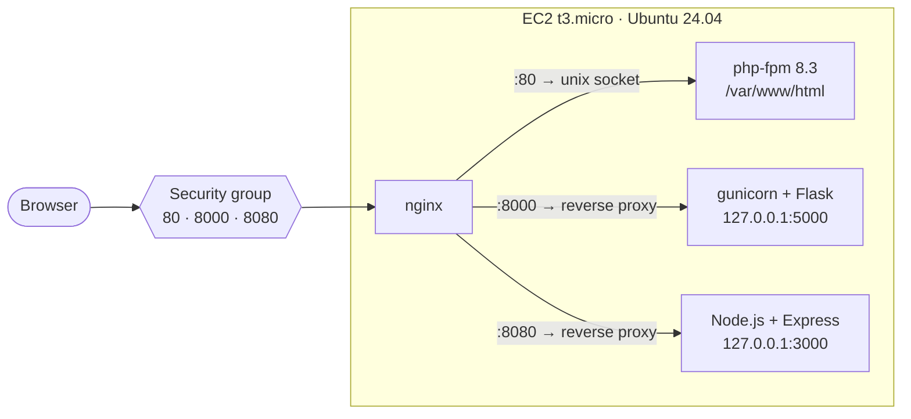
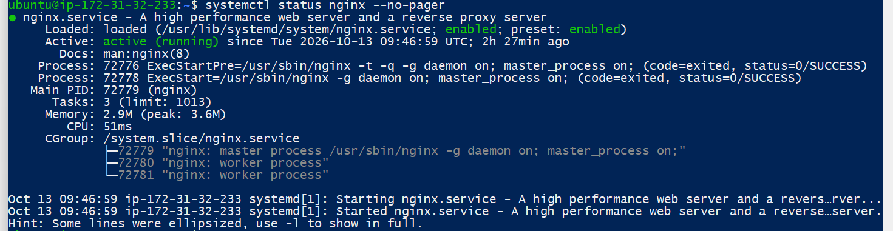
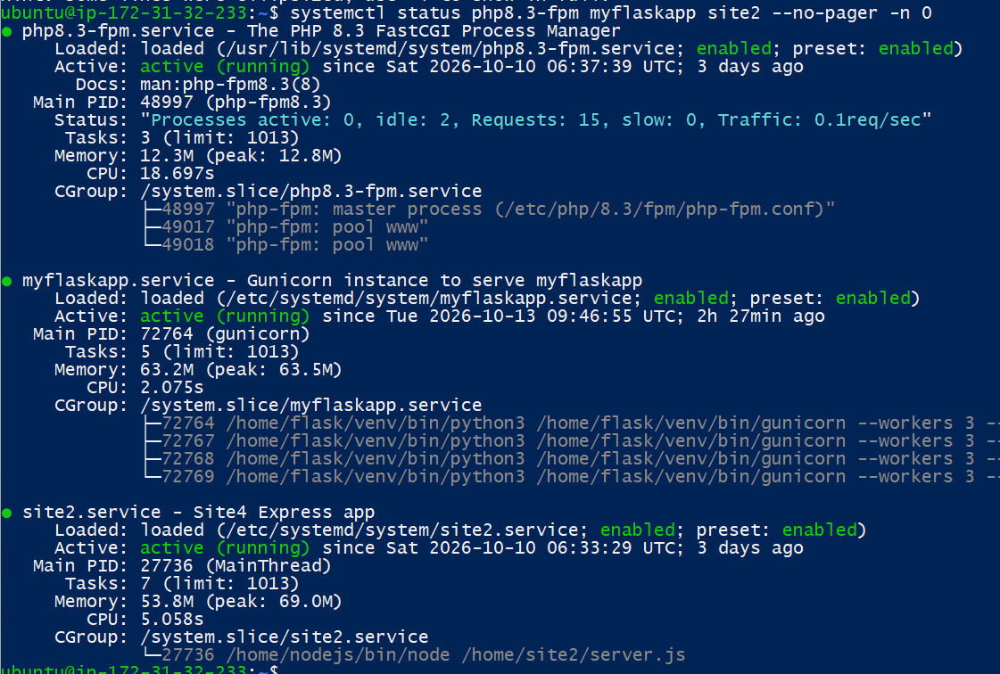
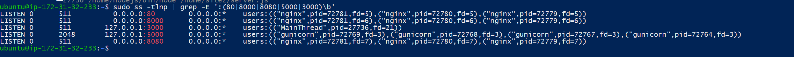
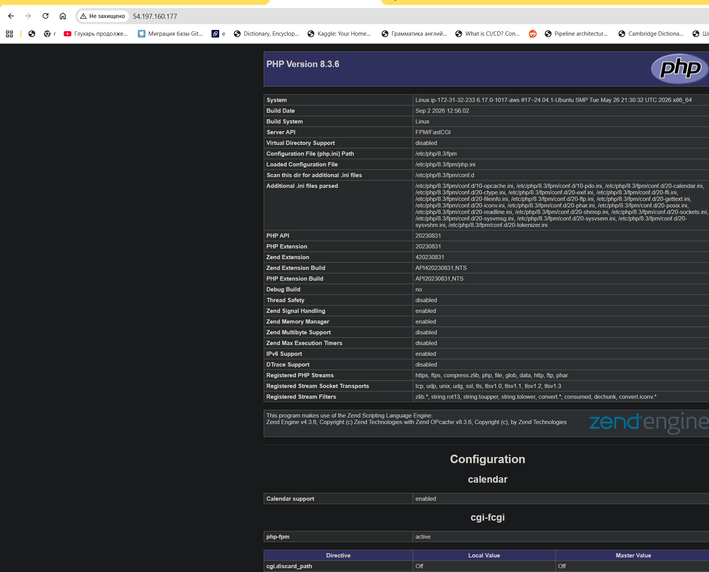
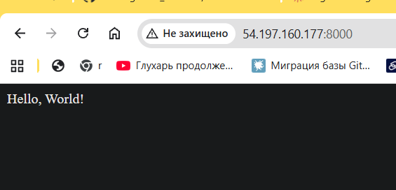
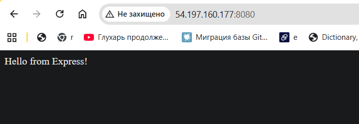
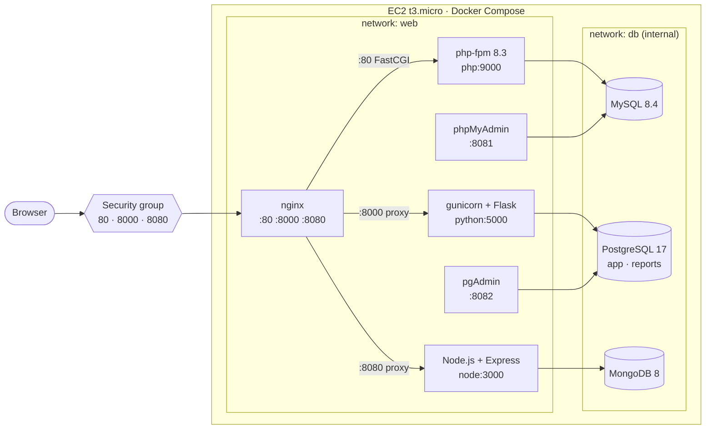

# AWS_TestTask

# AWS DevOps Lab — EC2, Nginx, Docker (PHP, Python, Node.js)

Hands-on DevOps practice following my mentor's roadmap.

- **Stage 1** — I launched an EC2 instance on AWS, installed nginx and deployed three web applications — PHP, Python (Flask) and Node.js (Express) — directly on the host. Each application is served by nginx on its own port.
- **Stage 2** (current) — everything runs in Docker containers with Docker Compose. Each application got its own database (PHP → MySQL, Python → PostgreSQL, Node.js → MongoDB) plus web admin tools (phpMyAdmin, pgAdmin). See [Stage 2 — Docker](#stage-2--docker).

## Task

### Stage 1

The assignment from my mentor:

1. Create an SSH key pair, launch a `t3.micro` instance, create a security group for HTTP/HTTPS (80/443), install nginx.
2. Create SSH keys locally and add the public key to the server — a dedicated key for GitHub/GitLab.
3. Create three sites in nginx on ports **80**, **8000** and **8080**. Use three repositories — Python, Node.js and PHP — and make them work.
4. Document everything in a README with screenshots. Learn to present the work.

### Stage 2

1. Put all applications into containers.
2. Add a database to each application: PHP → **MySQL**, Python → **PostgreSQL**, Node.js → **MongoDB**.
3. Add **phpMyAdmin** for MySQL and **pgAdmin** for PostgreSQL.
4. Web services must be in the `web` network, databases in the `db` network.
5. Create **two databases** in PostgreSQL. Show `psql` screenshots with the list of databases and the connections to the database.

## Status

Stage 1:

- [x] EC2 `t3.micro` instance with a key pair
- [x] Security group (22, 80, 443, 8000, 8080)
- [x] nginx installed and running
- [x] Site 1 — PHP on port 80
- [x] Site 2 — Python (Flask + gunicorn) on port 8000
- [x] Site 3 — Node.js (Express) on port 8080
- [x] Python and Node.js apps run as systemd services (start on boot, restart on failure)
- [ ] Dedicated SSH key for GitHub/GitLab CI → server
- [ ] Application code moved to Git repositories
- [ ] HTTPS (TLS certificate) on port 443

Stage 2:

- [x] Docker Engine + Compose installed on the server
- [x] PHP, Python, Node.js and nginx run in containers (systemd services and host nginx are disabled)
- [x] MySQL ← PHP, PostgreSQL ← Python, MongoDB ← Node.js
- [x] phpMyAdmin and pgAdmin
- [x] Networks: `web` for web services, `db` (internal) for databases
- [x] Two databases in PostgreSQL: `app` and `reports`
- [x] `psql` screenshots: list of databases and connections

## Architecture

> This section describes **Stage 1** (apps directly on the host). For the current Docker setup see [Stage 2 — Docker](#stage-2--docker).



| Site | Public port | Backend | Code location |
|---|---|---|---|
| 1 — PHP | 80 | php-fpm 8.3 (unix socket `/run/php/php8.3-fpm.sock`) | `/var/www/html` |
| 2 — Python | 8000 | gunicorn + Flask on `127.0.0.1:5000` | `/home/flask` |
| 3 — Node.js | 8080 | Express on `127.0.0.1:3000` | `/home/site2` |

nginx is the only process that listens on public ports. The application servers listen on `127.0.0.1` only, so they cannot be reached from the internet directly — all traffic goes through nginx.

## Environment

| Component | Version |
|---|---|
| Cloud | AWS EC2, region `us-east-1` (N. Virginia) |
| Instance type | `t3.micro` |
| OS | Ubuntu 24.04.4 LTS (kernel 6.17, AWS) |
| nginx | 1.24.0 |
| PHP | 8.3.6 (php-fpm) |
| Python | 3.12.3 (Flask, gunicorn) |
| Node.js | 24.21.0 (Express) |

Stage 2 (Docker):

| Component | Version |
|---|---|
| Root volume | EBS 20 GB (resized from 8 GB) + 2 GB swap |
| Docker Engine | 29.9.1 |
| Docker Compose | v5.6.0 |
| nginx | 1.27 (`nginx:1.27-alpine`) |
| PHP | 8.3 (`php:8.3-fpm-alpine`) |
| Python | 3.12 (`python:3.12-slim`) |
| Node.js | 24 (`node:24-alpine`) |
| MySQL | 8.4.11 |
| PostgreSQL | 17.11 |
| MongoDB | 8.3.13 |
| phpMyAdmin | 5.2 |
| pgAdmin | 9 |

## Step by step

### 1. Launch the EC2 instance

- **AMI:** Ubuntu Server 24.04 LTS
- **Instance type:** `t3.micro`
- **Key pair:** a new key pair; the private key was downloaded as a `.pem` file
- **Security group:** see the next step


### 2. Security group

Inbound rules:

| Port | Protocol | Source | Purpose |
|---|---|---|---|
| 22 | TCP | 0.0.0.0/0 | SSH (should be limited to my IP — see [Security notes](#security-notes)) |
| 80 | TCP | 0.0.0.0/0 | Site 1 — PHP |
| 443 | TCP | 0.0.0.0/0 | HTTPS (reserved, TLS is not configured yet) |
| 8000 | TCP | 0.0.0.0/0 | Site 2 — Flask |
| 8080 | TCP | 0.0.0.0/0 | Site 3 — Node.js |

Outbound: all traffic allowed (default).


### 3. Connect to the server

```bash
chmod 400 <key>.pem                      # Linux / WSL: private key must not be readable by others
ssh -i <key>.pem ubuntu@<EC2_PUBLIC_IP>
sudo -i
```

On Windows (PowerShell) the same is done with `icacls`:

```powershell
icacls .\<key>.pem /inheritance:r
icacls .\<key>.pem /grant:r "$($env:USERNAME):(R)"
```

### 4. Install nginx

```bash
apt update
apt install nginx
systemctl status nginx
curl localhost
```



### 5. Site 1 — PHP (port 80)

```bash
apt install php-fpm
systemctl status php8.3-fpm
```

The page is `/var/www/html/index.php`. nginx passes `.php` requests to php-fpm through a unix socket (see the nginx config in step 8).

### 6. Site 2 — Python / Flask (port 8000)

Create a virtual environment and install Flask and gunicorn:

```bash
apt install python3-venv
mkdir /home/flask && cd /home/flask
python3 -m venv venv
source venv/bin/activate
pip install flask gunicorn
```

Files in `/home/flask`:

- `app.py` — the Flask application (object `app`)
- `wsgi.py` — entry point for gunicorn, imports `app` from `app.py`

Test run:

```bash
gunicorn --bind 127.0.0.1:5000 wsgi:app
```

systemd unit `/etc/systemd/system/myflaskapp.service`:

```ini
[Unit]
Description=Gunicorn instance to serve myflaskapp
After=network.target

[Service]
WorkingDirectory=/home/flask
Environment="PATH=/home/flask/venv/bin"
ExecStart=/home/flask/venv/bin/gunicorn --workers 3 --bind 127.0.0.1:5000 wsgi:app
Restart=always

[Install]
WantedBy=multi-user.target
```

```bash
systemctl daemon-reload
systemctl enable --now myflaskapp
systemctl status myflaskapp
```

### 7. Site 3 — Node.js / Express (port 8080)

Node.js was installed from the official binary archive:

```bash
cd /home
wget https://nodejs.org/dist/v24.21.0/node-v24.21.0-linux-x64.tar.xz
tar xf node-v24.21.0-linux-x64.tar.xz
mv node-v24.21.0-linux-x64 /home/nodejs

echo 'export PATH="/home/nodejs/bin:$PATH"' >> ~/.profile
source ~/.profile
node -v
```

The application:

```bash
mkdir /home/site2 && cd /home/site2
npm init -y
npm install express
# server.js — Express app listening on port 3000
node server.js   # quick test
```

systemd unit `/etc/systemd/system/site2.service`:

```ini
[Unit]
Description=Node.js Express app (site 3)
After=network.target

[Service]
WorkingDirectory=/home/site2
Environment=NODE_ENV=production
Environment=PORT=3000
ExecStart=/home/nodejs/bin/node /home/site2/server.js
Restart=always
RestartSec=3

[Install]
WantedBy=multi-user.target
```

> systemd does not read `~/.profile`, so `ExecStart` uses the full path to `node`.

```bash
systemctl daemon-reload
systemctl enable --now site2
systemctl status site2
```



### 8. nginx configuration

`/etc/nginx/sites-available/default` (symlinked to `/etc/nginx/sites-enabled/`):

```nginx
# Site 1: PHP on port 80
server {
    listen 80 default_server;
    server_name _;
    root /var/www/html;
    index index.php index.html;

    location ~ \.php$ {
        include snippets/fastcgi-php.conf;
        fastcgi_pass unix:/run/php/php8.3-fpm.sock;
    }
}

# Site 2: Flask (gunicorn) on port 8000
server {
    listen 8000;
    server_name _;

    location / {
        include proxy_params;
        proxy_pass http://127.0.0.1:5000;
    }
}

# Site 3: Node.js (Express) on port 8080
server {
    listen 8080;
    server_name _;

    location / {
        include proxy_params;
        proxy_pass http://127.0.0.1:3000;
    }
}
```

Key points:

- **One `server` block per site** — each site has its own port (`listen`).
- **`server_name _`** — accept any host name, including requests to the bare IP.
- **`snippets/fastcgi-php.conf`** — standard Ubuntu snippet: sets `SCRIPT_FILENAME` and returns 404 if the PHP file does not exist.
- **`proxy_pass`** — nginx works as a reverse proxy for the Python and Node.js apps.
- **`proxy_params`** — passes the original `Host`, client IP (`X-Real-IP`, `X-Forwarded-For`) and protocol to the application.

### 9. Apply and verify

```bash
systemctl daemon-reload
systemctl restart myflaskapp          # first: gunicorn releases port 8000
nginx -t && systemctl restart nginx   # then: nginx takes 8000
ss -tlnp | grep -E ':(80|8000|8080|5000|3000)\b'
```

Result (simplified):

```
LISTEN  0.0.0.0:80       nginx
LISTEN  0.0.0.0:8000     nginx
LISTEN  0.0.0.0:8080     nginx
LISTEN  127.0.0.1:5000   gunicorn
LISTEN  127.0.0.1:3000   node
```

Local check from the server:

```bash
curl -s localhost:80   | head -5
curl -s localhost:8000 | head -5
curl -s localhost:8080 | head -5
```



Check from the browser — `http://<EC2_PUBLIC_IP>`, `:8000` and `:8080`:







### 10. SSH key for GitHub / GitLab (in progress)

A separate key pair that CI (GitHub Actions / GitLab CI) will use to connect to the server and deploy. It is **not** the AWS key pair.

On the local machine (no passphrase — CI cannot type it):

```powershell
ssh-keygen -t ed25519 -f $HOME\.ssh\ec2-cicd -C "github-gitlab-deploy"
type $HOME\.ssh\ec2-cicd.pub
```

On the server — add the public key for the `ubuntu` user:

```bash
echo "<contents of ec2-cicd.pub>" >> /home/ubuntu/.ssh/authorized_keys
```

Check the login with the new key:

```powershell
ssh -i $HOME\.ssh\ec2-cicd ubuntu@<EC2_PUBLIC_IP>
```

The private key is never committed. In the CI/CD stage it will be stored as a CI secret.

## Stage 2 — Docker

All three sites, their databases and the admin tools run as containers described in [docker-compose.yml](docker-compose.yml). The public ports stay the same as in Stage 1 (80, 8000, 8080), so for the user nothing changed.

### Architecture



| Service | Image | Networks | Host port | Purpose |
|---|---|---|---|---|
| `nginx` | `nginx:1.27-alpine` | web | 80, 8000, 8080 | Reverse proxy for the three sites |
| `php` | built from [php/Dockerfile](php/Dockerfile) (`php:8.3-fpm-alpine` + `pdo_mysql`, `mysqli`) | web, db | — | Site 1 |
| `python` | built from [python/Dockerfile](python/Dockerfile) (`python:3.12-slim`, gunicorn) | web, db | — | Site 2 |
| `node` | built from [node/Dockerfile](node/Dockerfile) (`node:24-alpine`) | web, db | — | Site 3 |
| `phpmyadmin` | `phpmyadmin:5.2` | web, db | 8081 | MySQL admin UI |
| `pgadmin` | `dpage/pgadmin4:9` | web, db | 8082 | PostgreSQL admin UI |
| `mysql` | `mysql:8.4` | db | — | Database for PHP |
| `postgres` | `postgres:17-alpine` | db | — | Database for Python |
| `mongo` | `mongo:8` | db | — | Database for Node.js |

### Networks

- **`web`** — nginx, the applications and the admin tools.
- **`db`** — the databases. The network is `internal: true`: containers in it have no internet access and their ports cannot be published to the host.
- The applications and the admin tools are connected to **both** networks — they serve HTTP on `web` and talk to their database on `db`. The databases are only in `db`, so nginx (and anything else on `web` only) cannot reach them.

Containers find each other by service name through Docker's DNS: nginx uses `php:9000`, `python:5000`, `node:3000`; the apps use `mysql`, `postgres`, `mongo`.

### Project files

| File | Purpose |
|---|---|
| [docker-compose.yml](docker-compose.yml) | All services, networks and volumes |
| [nginx/docker.conf](nginx/docker.conf) | nginx config for Docker: same three `server` blocks as [nginx/default](nginx/default), but backends are service names instead of `127.0.0.1` / unix socket |
| [php/Dockerfile](php/Dockerfile), [python/Dockerfile](python/Dockerfile), [node/Dockerfile](node/Dockerfile) | Application images. Python and Node.js run as a non-root user |
| [python/requirements.txt](python/requirements.txt) | Flask, gunicorn, psycopg, psycopg-pool |
| [postgres/init/01-create-databases.sh](postgres/init/01-create-databases.sh) | Creates the extra PostgreSQL databases on the first start |
| [pgadmin/servers.json](pgadmin/servers.json) | Pre-registers the PostgreSQL server in pgAdmin |
| [.env.example](.env.example) | Template for `.env`: passwords, database names, host ports |

The applications got a `/db` page that connects to their database and prints its version:

| URL | Result |
|---|---|
| `http://<EC2_PUBLIC_IP>/db.php` | `Connected to MySQL 8.4.11` |
| `http://<EC2_PUBLIC_IP>:8000/db` | `Connected to PostgreSQL 17.11 ...` |
| `http://<EC2_PUBLIC_IP>:8080/db` | `Connected to MongoDB 8.3.13` |

Databases start with a healthcheck, and the applications use `depends_on: condition: service_healthy`, so an app starts only when its database is ready. Data is kept in named volumes (`mysql_data`, `postgres_data`, `mongo_data`, `pgadmin_data`), so it survives `docker compose down` / `up`.

### Configuration: `.env`

All passwords and names are in `.env` next to `docker-compose.yml`. The file is in `.gitignore`; only [.env.example](.env.example) is committed.

```
MYSQL_ROOT_PASSWORD=...        MYSQL_DATABASE=app   MYSQL_USER=app   MYSQL_PASSWORD=...
POSTGRES_DB=app                POSTGRES_EXTRA_DATABASES=reports
POSTGRES_USER=app              POSTGRES_PASSWORD=...
MONGO_USER=app                 MONGO_PASSWORD=...
PGADMIN_EMAIL=...              PGADMIN_PASSWORD=...
PHP_PORT=80  PYTHON_PORT=8000  NODE_PORT=8080  PHPMYADMIN_PORT=8081  PGADMIN_PORT=8082
```

The host ports are variables so the stack can run on a machine where 80/8000/8080 are already taken (for example locally).

### Deploying to the server

**1. More disk space.** The 8 GB root volume had only 3.8 GB free, and the images take about 8 GB on disk (see [Problems](#problems-and-solutions)). The EBS volume was resized to 20 GB in the AWS console (EC2 → Volumes → Modify volume), then the partition and the file system were extended — no reboot needed:

```bash
lsblk                              # disk is 20G, partition still 7G
sudo growpart /dev/nvme0n1 1
sudo resize2fs /dev/nvme0n1p1
df -h /
```

**2. Swap.** `t3.micro` has 1 GB of RAM — not enough for three databases and pgAdmin. A 2 GB swap file:

```bash
sudo fallocate -l 2G /swapfile
sudo chmod 600 /swapfile
sudo mkswap /swapfile
sudo swapon /swapfile
echo '/swapfile none swap sw 0 0' | sudo tee -a /etc/fstab   # keep after reboot
free -h
```

**3. Docker Engine and Compose** from the official Docker repository:

```bash
sudo install -m 0755 -d /etc/apt/keyrings
sudo curl -fsSL https://download.docker.com/linux/ubuntu/gpg -o /etc/apt/keyrings/docker.asc
sudo chmod a+r /etc/apt/keyrings/docker.asc
echo "deb [arch=$(dpkg --print-architecture) signed-by=/etc/apt/keyrings/docker.asc] \
  https://download.docker.com/linux/ubuntu $(. /etc/os-release && echo $VERSION_CODENAME) stable" \
  | sudo tee /etc/apt/sources.list.d/docker.list
sudo apt-get update
sudo apt-get install -y docker-ce docker-ce-cli containerd.io docker-buildx-plugin docker-compose-plugin
sudo usermod -aG docker ubuntu     # docker without sudo after re-login
```

**4. Copy the project** to `~/AWS_TestTask` (from the local machine, Git Bash):

```bash
tar -cf - --exclude=.git --exclude=images --exclude=.env . \
  | ssh -i <key>.pem ubuntu@<EC2_PUBLIC_IP> 'mkdir -p ~/AWS_TestTask && tar -xf - -C ~/AWS_TestTask'
```

**5. `.env` with random passwords** (on the server):

```bash
cd ~/AWS_TestTask
cp .env.example .env
for v in MYSQL_ROOT_PASSWORD MYSQL_PASSWORD POSTGRES_PASSWORD MONGO_PASSWORD PGADMIN_PASSWORD; do
  sed -i "s|^$v=.*|$v=$(openssl rand -hex 16)|" .env
done
chmod 600 .env
```

**6. Build the images while the old sites still work**, then switch:

```bash
docker compose pull
docker compose build

# host nginx, php-fpm and the systemd apps hold ports 80/8000/8080
sudo systemctl disable --now nginx php8.3-fpm myflaskapp site2
docker compose up -d
docker compose ps
```

Downtime was only the few seconds between `disable --now` and `up -d`. The Stage 1 configs and unit files are still on the server, so rollback is:

```bash
docker compose down
sudo systemctl enable --now nginx php8.3-fpm myflaskapp site2
```

### PostgreSQL: two databases

The official `postgres` image creates one database — `POSTGRES_DB` (`app`, used by Flask). The second one (`reports`) is created by [postgres/init/01-create-databases.sh](postgres/init/01-create-databases.sh). Every `*.sh` / `*.sql` file mounted into `/docker-entrypoint-initdb.d/` runs once, on the first start with an empty data volume:

```sh
for db in $(echo "$POSTGRES_EXTRA_DATABASES" | tr ',' ' '); do
    psql -v ON_ERROR_STOP=1 -U "$POSTGRES_USER" -d postgres \
        -c "CREATE DATABASE \"$db\" OWNER \"$POSTGRES_USER\";"
done
```

From the container log:

```
/usr/local/bin/docker-entrypoint.sh: running /docker-entrypoint-initdb.d/01-create-databases.sh
Creating database: reports
CREATE DATABASE
```

> The init scripts do not run again when the volume already has data. To add a database later — create it by hand (`CREATE DATABASE ...`) or recreate the volume with `docker compose down -v` (this **deletes all data**).

Open `psql` inside the container:

```bash
docker compose exec postgres psql -U app -d app
```

List of databases (`\l`) — `app` and `reports` are ours, `postgres`, `template0`, `template1` are system databases:


Connections to the database:

```sql
SELECT pid, datname, usename, application_name, client_addr, backend_start::time(0), state
FROM pg_stat_activity
WHERE backend_type = 'client backend'
ORDER BY datname, pid;
```


- **3 × `flask`** from `172.19.0.6` — the `python` container in the `db` network. gunicorn runs 3 workers, and each worker keeps one open connection in its pool (`psycopg-pool`, `min_size=1`). The pool sets `application_name=flask`, so the connections are easy to find.
- **1 × `psql`** — my own session. `client_addr` is empty because `psql` connects through the local unix socket inside the container.
- Nothing is connected to `reports` yet — no application uses it.

## How the setup evolved: v1 → v2 → v3

The first version used **path-based routing** on port 80:

```
http://<IP>/site1/  →  PHP
http://<IP>/site2/  →  Flask    (127.0.0.1:8000)
http://<IP>/site3/  →  Node.js  (127.0.0.1:3000)
```

It worked, but:

- it did not match the task — the sites must be on ports 80, 8000 and 8080;
- an app behind a path prefix generates wrong links and redirects (for example `/login` instead of `/site2/login`) unless each app is configured to know its prefix;
- PHP with `alias` needed a manually built `SCRIPT_FILENAME`.

The second version is **port-based**: one `server` block per site. The config is simpler and there are no prefix problems. The v1 config is kept on the server as a backup (`/root/nginx-v1-path-based.conf`).

The third version (current, Stage 2) keeps the same port-based nginx config, but everything runs in **Docker**:

| | v2 — host | v3 — Docker |
|---|---|---|
| nginx | installed with `apt` | `nginx` container |
| PHP | php-fpm, unix socket | `php` container, `php:9000` |
| Python | systemd `myflaskapp`, `127.0.0.1:5000` | `python` container, `python:5000` |
| Node.js | systemd `site2`, `127.0.0.1:3000` | `node` container, `node:3000` |
| Isolation | apps bind to `127.0.0.1` | apps have no published ports; databases are in an internal network |
| Restart | `Restart=always` in systemd | `restart: unless-stopped` |
| Databases | none | MySQL, PostgreSQL, MongoDB + phpMyAdmin, pgAdmin |

## Problems and solutions

### Stage 1

**1. PHP script not found with `alias` (v1)**
- *Cause:* with `alias`, the default `$document_root$fastcgi_script_name` builds a wrong path to the file (`/var/www/html//site1/index.php`).
- *Fix:* `fastcgi_param SCRIPT_FILENAME $request_filename;`. In v2 the problem is gone: `root` + the standard snippet.

**2. `/site1` without a trailing slash did not open (v1)**
- *Cause:* `location /site1/` does not match the URL `/site1`.
- *Fix:* exact-match redirect `location = /site1 { return 301 /site1/; }`.

**3. gunicorn could not import the app**
- *Cause:* `wsgi.py` imports `app`, but the Flask file was named `touch.py`. The import refers to a local file, not to a pip package, so installing packages does not help.
- *Fix:* renamed the file to `app.py`.

**4. `node` / `npm` not found after unpacking the archive**
- *Cause:* `/home/nodejs/bin` was not in `PATH`. Running `~/.profile` as a command does not change the current shell.
- *Fix:* added `export PATH=...` to `~/.profile` and loaded it with `source ~/.profile`. In systemd — full path to `node`.

**5. Port 8000 conflict when moving to v2**
- *Cause:* gunicorn was listening on `127.0.0.1:8000`, but nginx needs `0.0.0.0:8000` for site 2.
- *Fix:* moved gunicorn to `127.0.0.1:5000` and restarted it before nginx.

### Stage 2

**6. Not enough disk space for the images**
- *Cause:* the 8 GB root volume had 3.8 GB free. The images take about 8 GB on disk — Docker keeps both the compressed layers and the unpacked ones. The disk would have filled up in the middle of the pull/build. (I hit exactly this when testing locally in WSL: the virtual disk filled the host drive, the file system became read-only, and the Docker build cache was corrupted.)
- *Fix:* checked `df -h` **before** installing anything; resized the EBS volume to 20 GB, then `growpart` + `resize2fs`.

**7. Not enough RAM on `t3.micro`**
- *Cause:* 1 GB of RAM (about 400 MB free) is not enough for MySQL, PostgreSQL, MongoDB and pgAdmin together — the kernel OOM killer would stop containers.
- *Fix:* added a 2 GB swap file. The stack works, but it is slow; a bigger instance (`t3.small` / `t3.medium`) would be better.

**8. Ports 80/8000/8080 already in use**
- *Cause:* the host nginx from Stage 1 still listened on these ports, so the `nginx` container could not bind them.
- *Fix:* built the images first (old sites still working), then `systemctl disable --now nginx php8.3-fpm myflaskapp site2` and right after it `docker compose up -d`. Host ports are configurable in `.env`, so the stack can also run where these ports are taken.

**9. Node.js app not reachable from nginx**
- *Cause:* `server.js` listened on `127.0.0.1` — inside a container this is the container's own loopback, so nginx from another container cannot connect.
- *Fix:* the address comes from the `HOST` variable: `0.0.0.0` in Docker, `127.0.0.1` by default (the systemd setup keeps working).

**10. Init script breaking because of Windows line endings**
- *Cause:* with `core.autocrlf=true` Git on Windows checks out `.sh` files with CRLF; `sh` in the container then fails on `\r`.
- *Fix:* [.gitattributes](.gitattributes) with `*.sh text eol=lf`.

## Security notes

- Only nginx is exposed to the internet. In Docker the applications have no published ports; the databases are in the internal `db` network and cannot be reached from the host or the internet.
- Database passwords are random (`openssl rand -hex 16`) and stored in `.env` (`chmod 600`, in `.gitignore`).
- The Python and Node.js containers run as a non-root user.
- phpMyAdmin (8081) and pgAdmin (8082) are published on the host, but these ports are **closed** in the security group. To use them — an SSH tunnel:
  ```bash
  ssh -i <key>.pem -L 8082:localhost:8082 ubuntu@<EC2_PUBLIC_IP>   # then open http://localhost:8082
  ```
  or open the port in the security group for my IP only — never for `0.0.0.0/0`.
- SSH (22) is open to `0.0.0.0/0` — it should be limited to my IP address.
- Port 443 is open, but TLS is not configured yet.
- Private keys (`.pem`, CI key) are never committed. The public IP and AWS account ID are hidden in this README and in the screenshots.

## Next steps

Roadmap:

1. Move the three applications to Git repositories and deploy from them
2. CI/CD pipeline (GitHub Actions / GitLab CI) using the dedicated SSH key
3. ~~Containerization (Docker)~~ — done in Stage 2
4. Load balancer
5. Infrastructure as Code with Terraform
6. ~~Databases: PostgreSQL and MySQL~~ — done in Stage 2 (+ MongoDB)

Small fixes:

- bind phpMyAdmin and pgAdmin to `127.0.0.1` on the host, so they are reachable only through the SSH tunnel even if the security group is opened by mistake;
- regenerate `node/package-lock.json` with `npm install` (the `mongodb` dependency was added without updating the lock file, so the image uses `npm install` instead of `npm ci`);
- use the `reports` database in an application;
- HTTPS for the sites.
