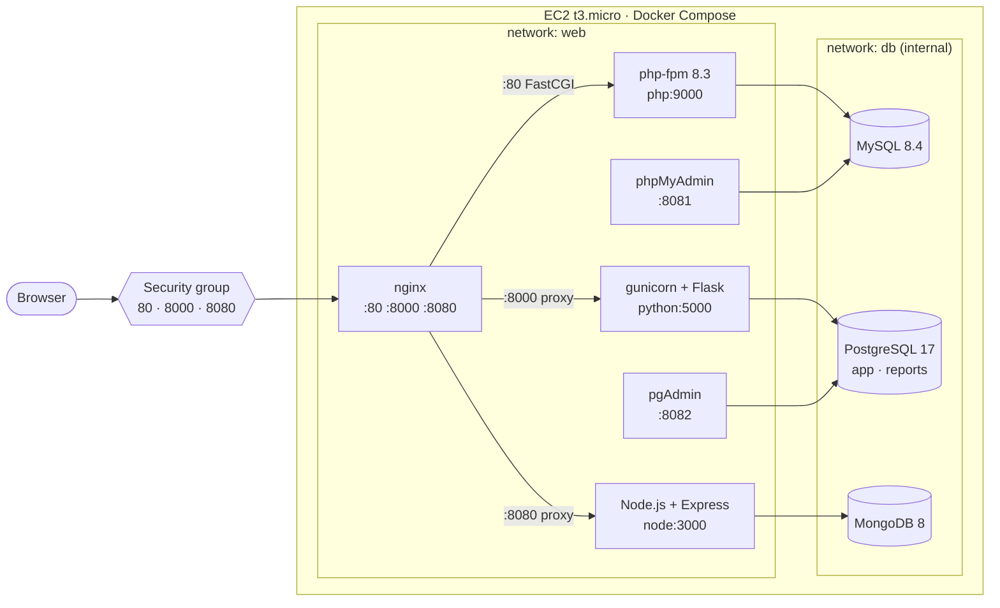

# Stage 2 — Docker Compose, manual deployment (archived)

> **Archived.** This is a snapshot of the Stage 2 documentation. Since then a shared Redis hit counter was added and the deployment is done with Ansible — see the [main README](../../README.md). The exact state of the repository at the end of this stage is commit `bebcfd5`:
>
> ```bash
> git show bebcfd5:docker-compose.yml
> git checkout bebcfd5 -- .   # or restore the whole tree
> ```

All three sites from [Stage 1](../stage1-host/README.md), their databases and the admin tools ran as containers described in `docker-compose.yml`. The public ports stayed the same as in Stage 1 (80, 8000, 8080), so for the user nothing changed.

## Task

1. Put all applications into containers.
2. Add a database to each application: PHP → **MySQL**, Python → **PostgreSQL**, Node.js → **MongoDB**.
3. Add **phpMyAdmin** for MySQL and **pgAdmin** for PostgreSQL.
4. Web services must be in the `web` network, databases in the `db` network.
5. Create **two databases** in PostgreSQL. Show `psql` screenshots with the list of databases and the connections to the database.

## Status at the end of the stage

- [x] Docker Engine + Compose installed on the server
- [x] PHP, Python, Node.js and nginx run in containers (systemd services and host nginx are disabled)
- [x] MySQL ← PHP, PostgreSQL ← Python, MongoDB ← Node.js
- [x] phpMyAdmin and pgAdmin
- [x] Networks: `web` for web services, `db` (internal) for databases
- [x] Two databases in PostgreSQL: `app` and `reports`
- [x] `psql` screenshots: list of databases and connections

## Architecture



| Service | Image | Networks | Host port | Purpose |
|---|---|---|---|---|
| `nginx` | `nginx:1.27-alpine` | web | 80, 8000, 8080 | Reverse proxy for the three sites |
| `php` | `php:8.3-fpm-alpine` + `pdo_mysql`, `mysqli` | web, db | — | Site 1 |
| `python` | `python:3.12-slim`, gunicorn | web, db | — | Site 2 |
| `node` | `node:24-alpine` | web, db | — | Site 3 |
| `phpmyadmin` | `phpmyadmin:5.2` | web, db | 8081 | MySQL admin UI |
| `pgadmin` | `dpage/pgadmin4:9` | web, db | 8082 | PostgreSQL admin UI |
| `mysql` | `mysql:8.4` | db | — | Database for PHP |
| `postgres` | `postgres:17-alpine` | db | — | Database for Python |
| `mongo` | `mongo:8` | db | — | Database for Node.js |

## Environment

| Component | Version |
|---|---|
| Root volume | EBS 20 GB (resized from 8 GB) + 2 GB swap |
| Docker Engine | 29.9.1 |
| Docker Compose | v5.6.0 |
| nginx | 1.27 (`nginx:1.27-alpine`) |
| PHP | 8.3 (`php:8.3-fpm-alpine`) |
| Python | 3.12 (`python:3.12-slim`) |
| Node.js | 24 (`node:24-alpine`) |
| MySQL | 8.4.11 |
| PostgreSQL | 17.11 |
| MongoDB | 8.3.13 |
| phpMyAdmin | 5.2 |
| pgAdmin | 9 |

## Manual deployment to the server

This is how the stack was deployed by hand. It is now automated with Ansible (see the [main README](../../README.md#deploy-with-ansible)).

**1. More disk space.** The 8 GB root volume had only 3.8 GB free, and the images take about 8 GB on disk. The EBS volume was resized to 20 GB in the AWS console (EC2 → Volumes → Modify volume), then the partition and the file system were extended — no reboot needed:

```bash
lsblk                              # disk is 20G, partition still 7G
sudo growpart /dev/nvme0n1 1
sudo resize2fs /dev/nvme0n1p1
df -h /
```

**2. Swap.** `t3.micro` has 1 GB of RAM — not enough for three databases and pgAdmin. A 2 GB swap file:

```bash
sudo fallocate -l 2G /swapfile
sudo chmod 600 /swapfile
sudo mkswap /swapfile
sudo swapon /swapfile
echo '/swapfile none swap sw 0 0' | sudo tee -a /etc/fstab   # keep after reboot
free -h
```

**3. Docker Engine and Compose** from the official Docker repository:

```bash
sudo install -m 0755 -d /etc/apt/keyrings
sudo curl -fsSL https://download.docker.com/linux/ubuntu/gpg -o /etc/apt/keyrings/docker.asc
sudo chmod a+r /etc/apt/keyrings/docker.asc
echo "deb [arch=$(dpkg --print-architecture) signed-by=/etc/apt/keyrings/docker.asc] \
  https://download.docker.com/linux/ubuntu $(. /etc/os-release && echo $VERSION_CODENAME) stable" \
  | sudo tee /etc/apt/sources.list.d/docker.list
sudo apt-get update
sudo apt-get install -y docker-ce docker-ce-cli containerd.io docker-buildx-plugin docker-compose-plugin
sudo usermod -aG docker ubuntu     # docker without sudo after re-login
```

**4. Copy the project** to `~/AWS_TestTask` (from the local machine, Git Bash):

```bash
tar -cf - --exclude=.git --exclude=images --exclude=.env . \
  | ssh -i <key>.pem ubuntu@<EC2_PUBLIC_IP> 'mkdir -p ~/AWS_TestTask && tar -xf - -C ~/AWS_TestTask'
```

**5. `.env` with random passwords** (on the server):

```bash
cd ~/AWS_TestTask
cp .env.example .env
for v in MYSQL_ROOT_PASSWORD MYSQL_PASSWORD POSTGRES_PASSWORD MONGO_PASSWORD PGADMIN_PASSWORD; do
  sed -i "s|^$v=.*|$v=$(openssl rand -hex 16)|" .env
done
chmod 600 .env
```

**6. Build the images while the old sites still work**, then switch:

```bash
docker compose pull
docker compose build

# host nginx, php-fpm and the systemd apps hold ports 80/8000/8080
sudo systemctl disable --now nginx php8.3-fpm myflaskapp site2
docker compose up -d
docker compose ps
```

Downtime was only the few seconds between `disable --now` and `up -d`. The Stage 1 configs and unit files were still on the server, so rollback was:

```bash
docker compose down
sudo systemctl enable --now nginx php8.3-fpm myflaskapp site2
```

## How the setup changed: host → Docker

| | v2 — host (Stage 1) | v3 — Docker (Stage 2) |
|---|---|---|
| nginx | installed with `apt` | `nginx` container |
| PHP | php-fpm, unix socket | `php` container, `php:9000` |
| Python | systemd `myflaskapp`, `127.0.0.1:5000` | `python` container, `python:5000` |
| Node.js | systemd `site2`, `127.0.0.1:3000` | `node` container, `node:3000` |
| Isolation | apps bind to `127.0.0.1` | apps have no published ports; databases are in an internal network |
| Restart | `Restart=always` in systemd | `restart: unless-stopped` |
| Databases | none | MySQL, PostgreSQL, MongoDB + phpMyAdmin, pgAdmin |

## Problems and solutions

**6. Not enough disk space for the images**
- *Cause:* the 8 GB root volume had 3.8 GB free. The images take about 8 GB on disk — Docker keeps both the compressed layers and the unpacked ones. The disk would have filled up in the middle of the pull/build. (I hit exactly this when testing locally in WSL: the virtual disk filled the host drive, the file system became read-only, and the Docker build cache was corrupted.)
- *Fix:* checked `df -h` **before** installing anything; resized the EBS volume to 20 GB, then `growpart` + `resize2fs`.

**7. Not enough RAM on `t3.micro`**
- *Cause:* 1 GB of RAM (about 400 MB free) is not enough for MySQL, PostgreSQL, MongoDB and pgAdmin together — the kernel OOM killer would stop containers.
- *Fix:* added a 2 GB swap file. The stack works, but it is slow; a bigger instance (`t3.small` / `t3.medium`) would be better.

**8. Ports 80/8000/8080 already in use**
- *Cause:* the host nginx from Stage 1 still listened on these ports, so the `nginx` container could not bind them.
- *Fix:* built the images first (old sites still working), then `systemctl disable --now nginx php8.3-fpm myflaskapp site2` and right after it `docker compose up -d`. Host ports are configurable in `.env`, so the stack can also run where these ports are taken.

**9. Node.js app not reachable from nginx**
- *Cause:* `server.js` listened on `127.0.0.1` — inside a container this is the container's own loopback, so nginx from another container cannot connect.
- *Fix:* the address comes from the `HOST` variable: `0.0.0.0` in Docker, `127.0.0.1` by default (the systemd setup keeps working).

**10. Init script breaking because of Windows line endings**
- *Cause:* with `core.autocrlf=true` Git on Windows checks out `.sh` files with CRLF; `sh` in the container then fails on `\r`.
- *Fix:* `.gitattributes` with `*.sh text eol=lf`.
